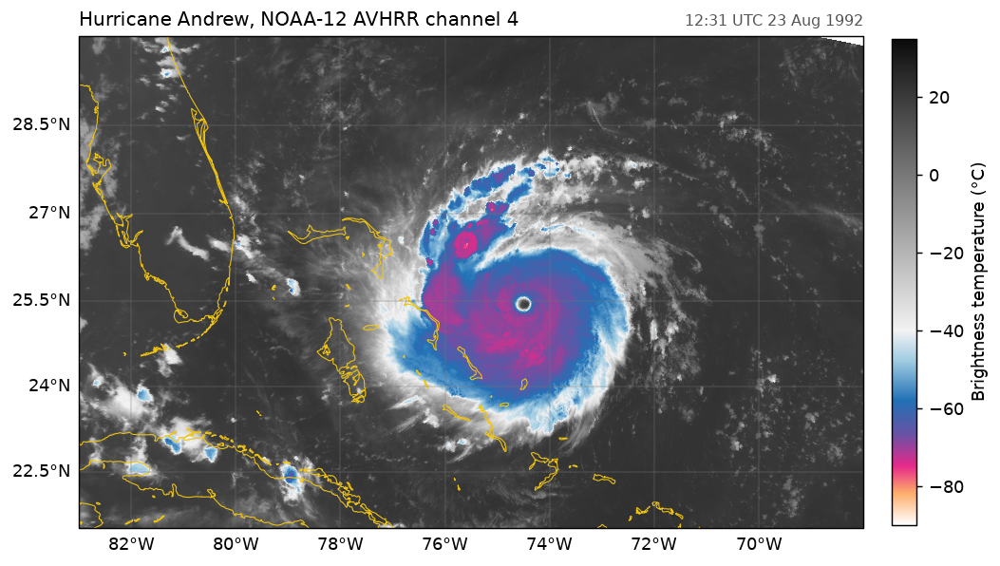

# Hurricane Andrew, 1992

Hurricane Andrew over the Bahamas, the day before it struck south Florida, in NOAA-12 AVHRR channel 4 (10.8 µm). `fastnc.Dataset` returns the channel in degrees Celsius, masked and scaled, with a latitude and longitude for every pixel.



Data: NOAA-12 AVHRR HRPT pass, 12:31-12:43 UTC 23 August 1992, converted to netCDF-4 with NOAA's CoastWatch Utilities.

```python title="docs/examples/avhrr_andrew.py"
--8<-- "avhrr_andrew.py"
```
