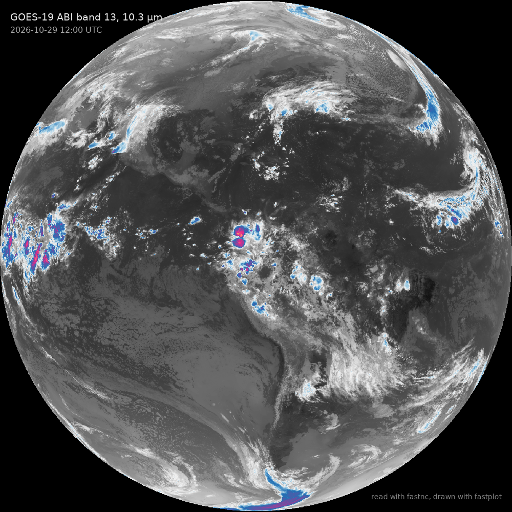

# GOES-19 full disk

GOES-19's full disk in ABI band 13, the 10.3 µm clean longwave window: 5424 × 5424 radiances read with `fastnc.Dataset`, masked and scaled as netCDF4-python gives them, then turned into brightness temperature with the Planck coefficients stored in the same file. Cloud tops colder than about −40 °C are in colour.



Data: GOES-19 ABI L1b full disk, band 13, 12:00 UTC 29 October 2026, from NOAA's `noaa-goes19` bucket on AWS.

```python title="docs/examples/goes_full_disk.py"
--8<-- "goes_full_disk.py"
```
