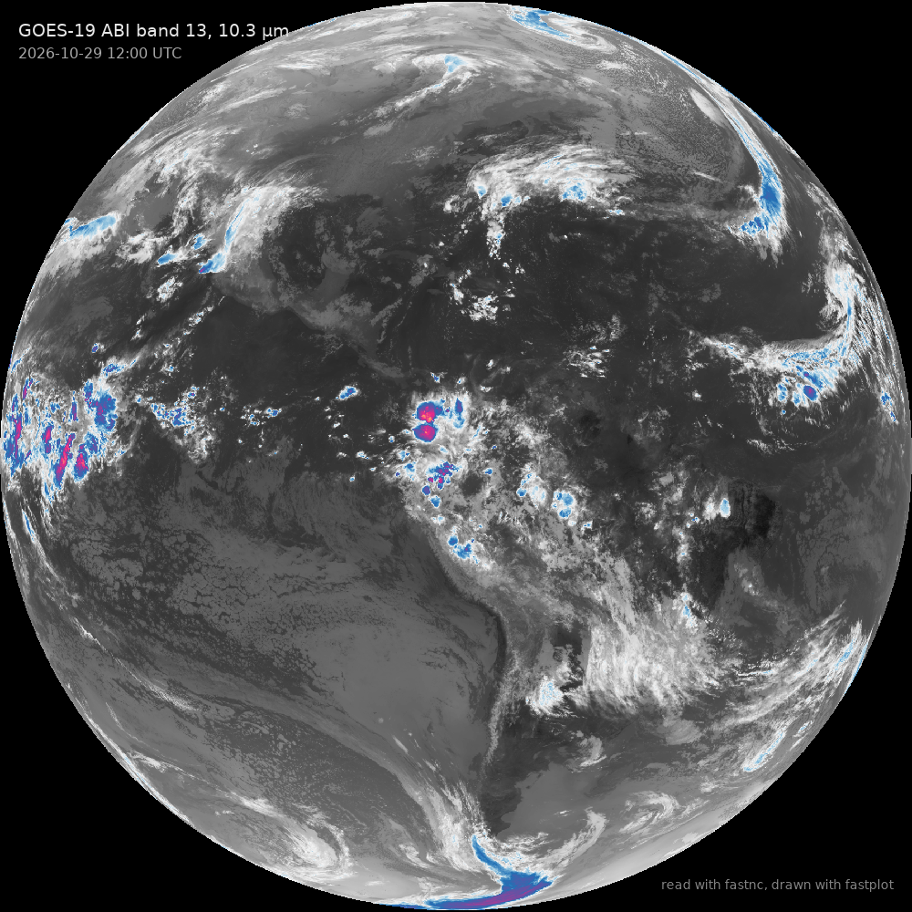
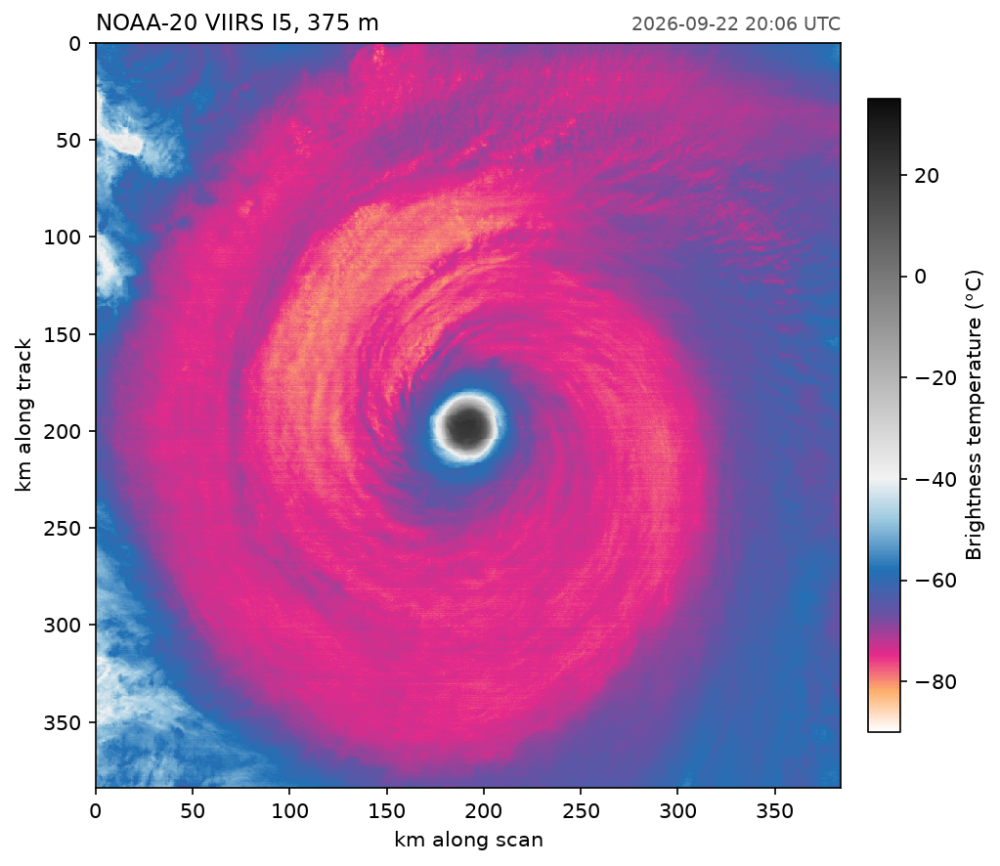
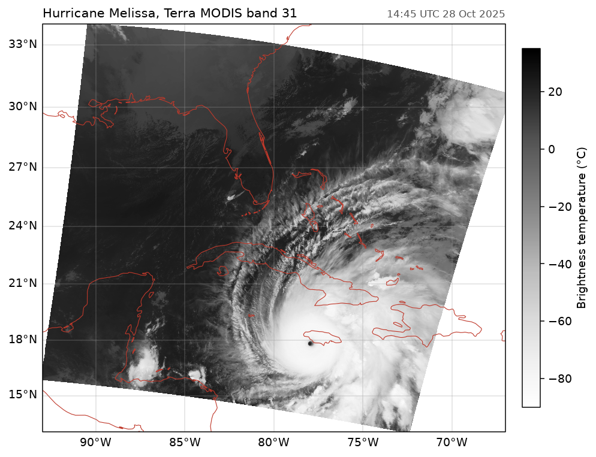
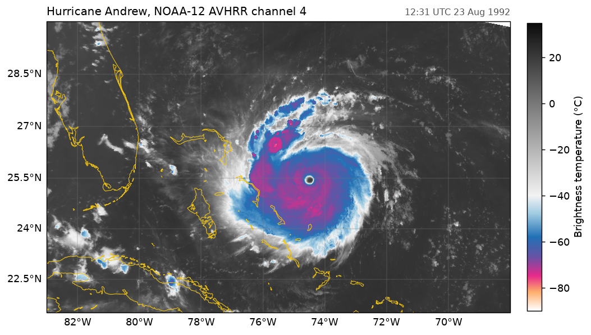
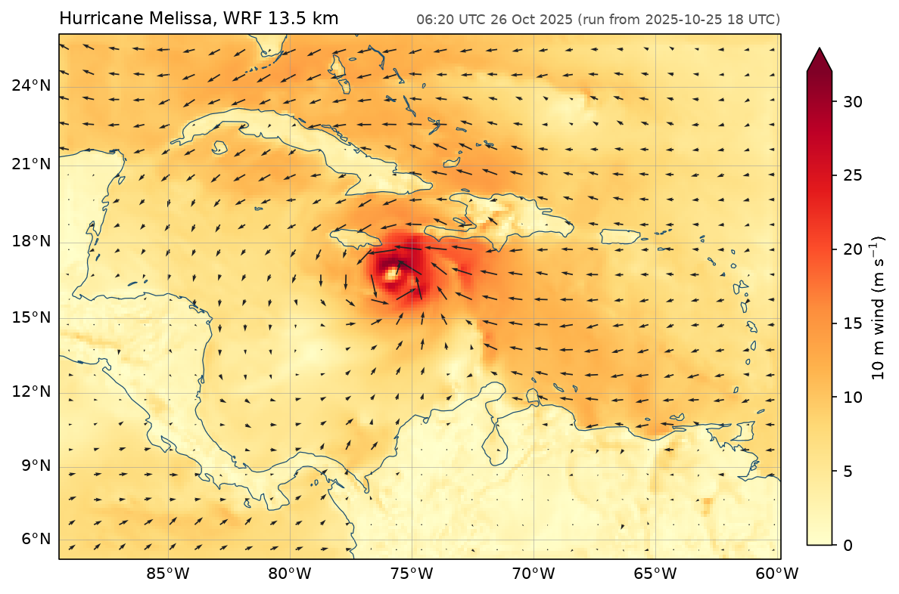
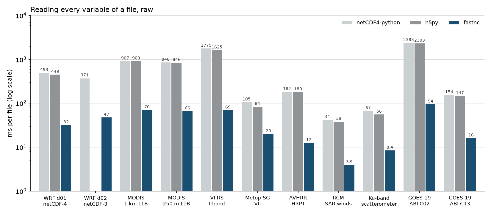

---
hide:
  - toc
---

# Gallery

Each example is a complete script with the figure it produces. The data are read with fastnc's three interfaces (the netCDF4-style `Dataset`, the h5py-style `File` and the xarray engine) and drawn with [fastplot](https://rochy111.github.io/fastplot/). The scripts are in `docs/examples/`.

## Satellites

<a class="card" href="goes_full_disk/">

GOES-19 full diskBand 13 brightness temperature, with Dataset

</a>
<a class="card" href="viirs_window/">

A hurricane's eye at 375 mA window of VIIRS I5, with File

</a>
<a class="card" href="modis_melissa/">

Hurricane Melissa from MODISAn HDF-EOS swath on a map, with File

</a>
<a class="card" href="avhrr_andrew/">

Hurricane Andrew, 1992A NOAA-12 AVHRR pass, with Dataset

</a>

## Models and speed

<a class="card" href="wrf_melissa/">

Hurricane Melissa in WRF10 m wind, with the xarray engine

</a>
<a class="card" href="speed_chart/">

Benchmark chartReading every variable against netCDF4-python and h5py

</a>

