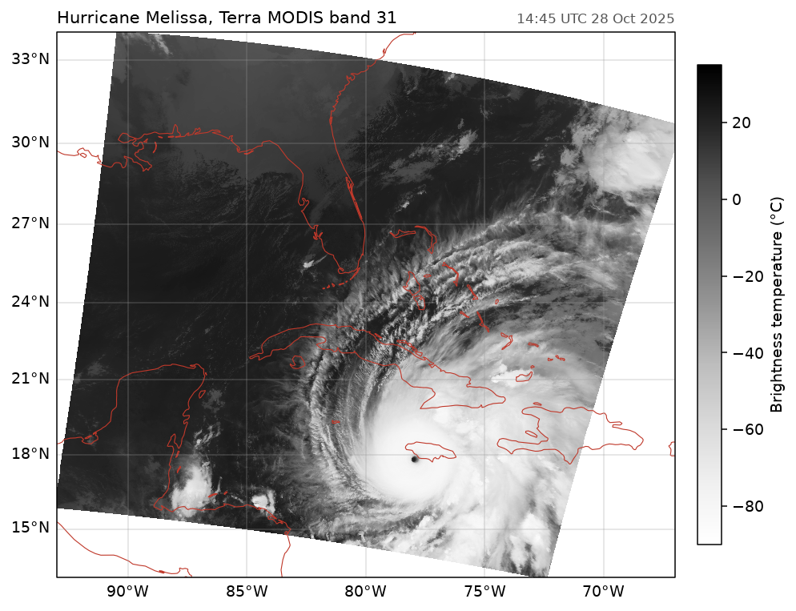

# Hurricane Melissa from MODIS

Hurricane Melissa a few hours before landfall in Jamaica, in Terra MODIS band 31 (11 µm). `fastnc.File` reads the scaled integers and their radiance scales and offsets from the HDF-EOS swath, and Planck's law gives the brightness temperature. The geolocation is stored every 5th pixel; the script interpolates it to every 1 km pixel, scan by scan.



Data: MODIS/Terra L1B 1 km granule (MOD021KM, version 007, as netCDF-4), 14:45 UTC 28 October 2025.

```python title="docs/examples/modis_melissa.py"
--8<-- "modis_melissa.py"
```
