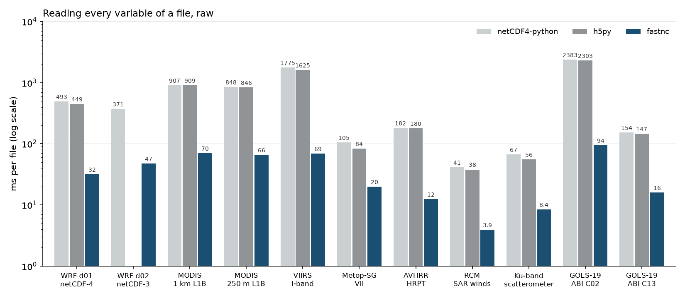

# Benchmark chart

Milliseconds to read every variable of eleven files, raw: netCDF4-python, h5py and fastnc. h5py does not read netCDF-3, so WRF d02 has no h5py bar.



Data: `docs/benchmarks.json`, the measurements on the [performance page](../speed.md).

```python title="docs/examples/speed_chart.py"
--8<-- "speed_chart.py"
```
