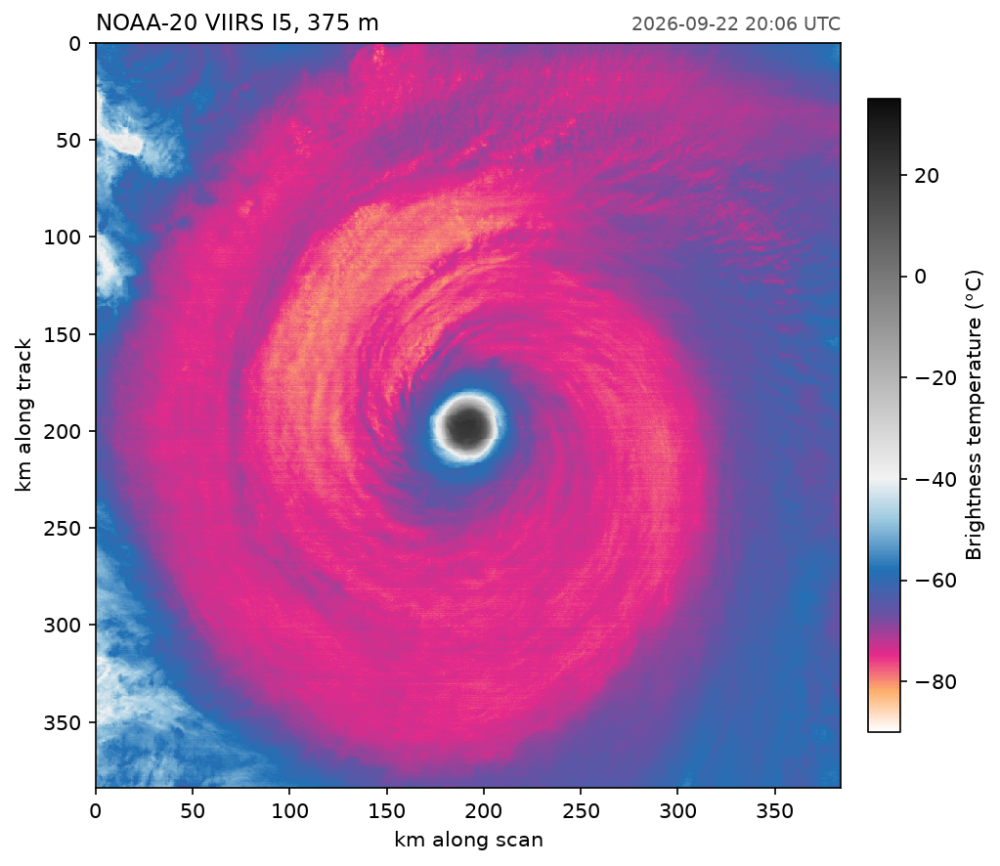

# A hurricane's eye at 375 m

A 1024 × 1024 window of NOAA-20 VIIRS band I5 around the eye of an eastern Pacific hurricane, read with `fastnc.File`, the h5py-style API. The variable is stored in strips of 32 rows, so fastnc reads 32 of its 202 chunks. The counts become brightness temperatures through the lookup table stored next to them.



Data: VIIRS I-band L1B (VJ102IMG, near real time), 20:06 UTC 22 September 2026.

```python title="docs/examples/viirs_window.py"
--8<-- "viirs_window.py"
```
