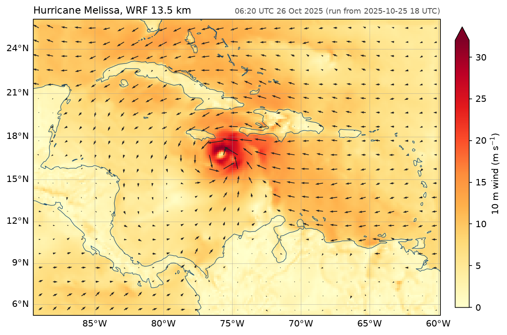

# Hurricane Melissa in WRF

The 10 m wind of Hurricane Melissa south of Jamaica in a 13.5 km WRF run. The wrfout file is opened by xarray with `engine='fastnc'`, and XLAT and XLONG come along as coordinates, as they do with the netcdf4 engine.



Data: `wrfout_d01_2025-10-26_06_20_00.nc`, a WRF 4.8 run started at 18 UTC 25 October 2025, on a Mercator grid.

```python title="docs/examples/wrf_melissa.py"
--8<-- "wrf_melissa.py"
```
