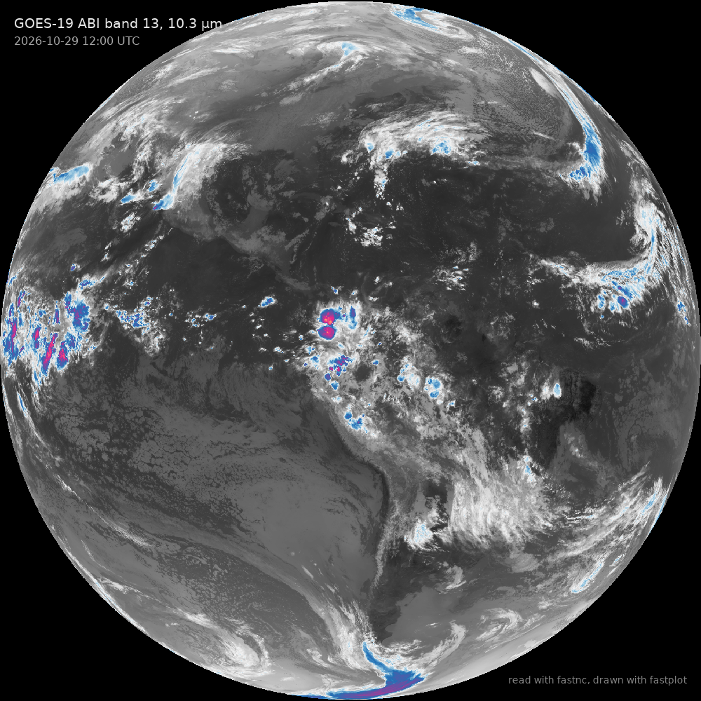

---
hide:
  - navigation
  - toc
---

<div class="home-hero" markdown>
<div markdown>

# fastnc

<p class="lede">netCDF and HDF5 reading for Python. fastnc reads netCDF-3,
netCDF-4, HDF5 and HDF4 files, from disk or from HTTP and S3, on every CPU core
or straight to an NVIDIA GPU, and every value is bit for bit what
netCDF4-python and h5py return.</p>

<div class="install" markdown>

```bash
pip install git+https://github.com/Rochy111/fastnc
```

</div>

[Get started](getting-started.md){ .md-button .md-button--primary }
[Browse the gallery](gallery/index.md){ .md-button }

</div>
<div markdown>



</div>
</div>

<div class="facts">
<div><span class="num">10–25×</span><span class="what">faster than netCDF4-python and h5py reading whole satellite and model files</span></div>
<div><span class="num">94 ms</span><span class="what">for a GOES-19 full disk at 0.5 km, where netCDF4-python takes 2.4 s</span></div>
<div><span class="num">7,000</span><span class="what">tests compare every variable with what the reference readers return</span></div>
<div><span class="num">2</span><span class="what">required dependencies: numpy and numba</span></div>
</div>

## Overview

fastnc is a read-only replacement for netCDF4-python and h5py. It has both
of their APIs, so switching is an import change, and an xarray backend. It
decompresses on every core at once, straight into the output array, with its
own implementations of deflate and every common HDF5 filter, and can send the
result to the GPU as a cupy array.

It reads the files that weather and climate work runs on: WRF output, CMIP
and reanalysis netCDF-4, and satellite products as their agencies distribute
them, including GOES ABI, VIIRS, MODIS, Metop-SG and AVHRR, in every HDF5
chunk index and with deflate, shuffle, szip, scale-offset, n-bit, zstd, lz4,
blosc and others.

## Beyond the reference readers

fastnc also does things netCDF4-python and h5py do not:

- **`memmap()`**: an uncompressed variable as a read-only view of the
  file's bytes, with no copy, reading only what you slice.
- **`read_async()` and `load_async()`**: a read runs on a worker and
  returns a `Future`, so the next frame loads while you work on this one.
- **`set_auto_nan(True)`**: masked floats come back as NaN in plain
  arrays, as xarray gives them, filled while decoding.
- **`read(key, mask=False, scale=False)`**: settings for one read only,
  safe across threads, and `out=` decodes into an array you already have.
- **`tocdl()`**: the header as `ncdump -h` prints it, byte for byte,
  without the ncdump program.
- **`MFDataset`** for netCDF-4, HDF5 and HDF4 files, and
  **`hdf4_datasets()`** for HDF4 data sets that share a name.

## Example

```python
import fastnc

ds = fastnc.Dataset('wrfout_d01_2025-10-26_06_20_00.nc')   # netCDF4.Dataset's API
t2 = ds['T2'][0]                                         # masked and scaled as netCDF4-python
everything = ds.load()                                   # every variable, all chunks in one pass

f = fastnc.File('VJ102IMG_NRT.A2026265.2006.021.nc')       # h5py.File's API
i05 = f['observation_data/I05'][3000:3512, 3000:3512]

import xarray as xr
xd = xr.open_dataset('MOD021KM.A2025301.1445.007.2025301204859.nc', engine='fastnc')

rad = ds['T'].read(device='gpu')                         # a cupy array, same values
```

## Compared with the reference readers

| | fastnc | netCDF4-python | h5py |
|---|---|---|---|
| Values | theirs, to the bit ([one rule on purpose](reference/accuracy.md#where-fastnc-differs-on-purpose)) | the reference | the reference |
| Whole GOES-19 full disk, 0.5 km | 94 ms | 2,383 ms | 2,303 ms |
| Whole WRF output file | 32 ms | 493 ms | 449 ms |
| Decompression | every core, one kernel | one chunk at a time | one chunk at a time |
| Formats | netCDF-3, netCDF-4, HDF5, HDF4 | netCDF-3, netCDF-4, HDF4 in some builds | HDF5 |
| Remote files | HTTP(S) and S3 byte ranges | with netCDF-c's byte-range mode | through fsspec |
| GPU | reads into cupy | no | no |
| Zero-copy views of the file | `memmap()` | no | no |
| Background reads | `read_async()`, `load_async()` | no | no |
| `ncdump -h` header | built in | needs the ncdump program | no |
| Complex numbers | `auto_complex=True` | `auto_complex=True` | native |
| Writes files | no | yes | yes |

The [performance page](speed.md) has every file and how they were measured.
