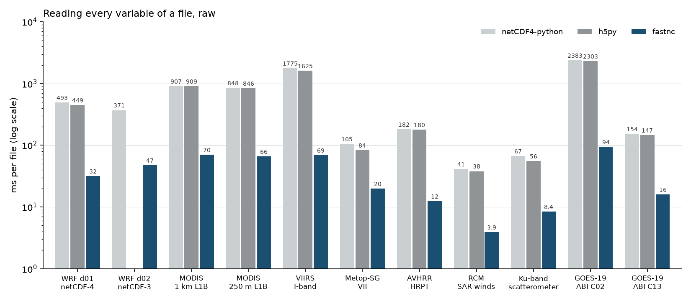

# Performance



## How it was measured

On an Intel i7-13700K (8 performance and 8 efficiency cores, 24 threads)
with an RTX 5070 Ti, under Windows 11, with Python 3.12, numpy 2.5 and
numba 0.68, against h5py 3.16, netCDF4-python 1.7.4, xarray 2026.9 and
h5netcdf 1.8. fastnc runs on every thread unless a row says otherwise.

- **Files** are in the operating system's cache, each read once before
  timing. From an NVMe drive with a cold cache, fastnc reads 10 to 18 times
  faster than h5py ([measurements](measurements.md)).
- **Each cell** is the best of 5 runs with the readers taking turns run by
  run, and the lower of two full benchmark runs, for every reader alike.
- **Raw** reads have masking and scaling off. **Masked** reads are
  netCDF4-python's defaults, which fastnc gives the same values for.
- **"First read"** is a fresh Python process, timed from just before the
  import, best of three processes.

The files are real ones, as their producers distribute them:

- two WRF runs: d01 is netCDF-4 with deflate and shuffle, d02 netCDF-3
- satellite products: MODIS L1B, VIIRS, Metop-SG VII, AVHRR, RCM SAR
  winds, a Ku-band scatterometer, and GOES-19 ABI full disks from NOAA's S3
  bucket

The readers take turns, and netCDF4-python and h5py take seconds on the
bigger files, so each fastnc read here starts after what fastnc keeps
between reads has been let go, on fresh memory. A loop of reads one after
another is faster still: a GOES C02 full disk takes 61 ms rather than 94.

These were measured on 2026-11-02 (`tools/bench.py`, with the tables made by
`tools/bench_table.py` from [benchmarks.json](benchmarks.json)).

## Whole files

Every variable of every group, in milliseconds, with fastnc's speed-up in
brackets. "fastnc" is `Dataset.load()`. "fastnc loop" is the same loop over
the variables as netCDF4-python's column, which the ratio is to; fastnc reads
ahead there.

**Raw**

| File | fastnc | fastnc loop | netCDF4-python | h5py |
|---|---:|---:|---:|---:|
| WRF d01, netCDF-4 | 31.9 | 41.2 | 493 (12.0×) | 449 (14.1×) |
| WRF d02, netCDF-3 | 47.5 | 58.3 | 371 (6.4×) | – |
| MODIS 1 km L1B | 70.0 | 88.1 | 907 (10.3×) | 909 (13.0×) |
| MODIS 250 m L1B | 66.2 | 63.0 | 848 (13.5×) | 846 (12.8×) |
| VIIRS I-band | 69.2 | 79.7 | 1,775 (22.3×) | 1,625 (23.5×) |
| Metop-SG VII | 19.9 | 25.2 | 105 (4.2×) | 84.0 (4.2×) |
| AVHRR HRPT | 12.5 | 13.0 | 182 (13.9×) | 180 (14.4×) |
| RCM SAR winds | 3.9 | 5.3 | 41.4 (7.8×) | 38.0 (9.7×) |
| Ku scatterometer | 8.4 | 12.0 | 66.8 (5.6×) | 55.7 (6.7×) |
| GOES-19 ABI full disk, C02 | 94.2 | 95.9 | 2,383 (24.8×) | 2,303 (24.5×) |
| GOES-19 ABI full disk, C13 | 16.0 | 13.1 | 154 (11.8×) | 147 (9.2×) |

**Masked and scaled**, as netCDF4-python does by default

| File | fastnc | fastnc loop | netCDF4-python |
|---|---:|---:|---:|
| WRF d01, netCDF-4 | 36.7 | 45.4 | 540 (11.9×) |
| WRF d02, netCDF-3 | 61.2 | 68.3 | 476 (7.0×) |
| MODIS 1 km L1B | 86.1 | 100 | 1,107 (11.0×) |
| MODIS 250 m L1B | 79.1 | 71.4 | 1,008 (14.1×) |
| VIIRS I-band | 116 | 117 | 3,048 (26.2×) |
| Metop-SG VII | 37.7 | 43.1 | 268 (6.2×) |
| AVHRR HRPT | 14.6 | 16.2 | 211 (13.0×) |
| RCM SAR winds | 7.4 | 8.3 | 45.1 (5.4×) |
| Ku scatterometer | 11.1 | 16.0 | 71.4 (4.5×) |
| GOES-19 ABI full disk, C02 | 150 | 142 | 4,823 (33.8×) |
| GOES-19 ABI full disk, C13 | 32.8 | 19.1 | 309 (16.2×) |

## One variable

Opening the file and reading one variable whole, raw, in milliseconds.
`fastnc.Dataset` is compared with netCDF4-python and `fastnc.File` with
h5py.

| File | fastnc | netCDF4-python | fastnc.File | h5py |
|---|---:|---:|---:|---:|
| WRF d01, netCDF-4 | 5.5 | 43.6 (7.9×) | 4.3 | 26.7 (6.2×) |
| WRF d02, netCDF-3 | 2.5 | 17.2 (6.8×) | – | – |
| MODIS 1 km L1B | 36.5 | 312 (8.5×) | 37.7 | 308 (8.2×) |
| MODIS 250 m L1B | 57.2 | 623 (10.9×) | 64.3 | 622 (9.7×) |
| VIIRS I-band | 14.2 | 173 (12.1×) | 11.6 | 167 (14.4×) |
| Metop-SG VII | 2.8 | 15.5 (5.5×) | 1.9 | 3.7 (1.9×) |
| AVHRR HRPT | 2.3 | 17.2 (7.6×) | 2.2 | 14.7 (6.8×) |
| RCM SAR winds | 0.98 | 5.1 (5.2×) | 0.81 | 2.2 (2.7×) |
| Ku scatterometer | 2.6 | 16.9 (6.6×) | 2.0 | 10.9 (5.5×) |
| GOES-19 ABI full disk, C02 | 82.8 | 1,999 (24.1×) | 84.6 | 1,964 (23.2×) |
| GOES-19 ABI full disk, C13 | 11.1 | 127 (11.4×) | 11.3 | 121 (10.7×) |

**A window of it**, a 256 × 256 or 512 × 512 block, raw:

| File | fastnc | netCDF4-python | fastnc.File | h5py |
|---|---:|---:|---:|---:|
| WRF d01, netCDF-4 | 3.9 | 21.5 (5.6×) | 2.7 | 5.8 (2.1×) |
| WRF d02, netCDF-3 | 1.2 | 4.0 (3.4×) | – | – |
| MODIS 1 km L1B | 25.8 | 114 (4.4×) | 25.4 | 110 (4.3×) |
| MODIS 250 m L1B | 10.0 | 119 (11.8×) | 16.2 | 116 (7.2×) |
| VIIRS I-band | 2.0 | 11.0 (5.5×) | 1.6 | 7.2 (4.4×) |
| Metop-SG VII | 1.7 | 11.7 (6.7×) | 0.83 | 1.2 (1.5×) |
| AVHRR HRPT | 1.2 | 5.3 (4.3×) | 1.1 | 3.2 (2.9×) |
| RCM SAR winds | 0.88 | 4.8 (5.4×) | 0.74 | 2.0 (2.6×) |
| Ku scatterometer | 1.7 | 8.9 (5.2×) | 1.3 | 3.5 (2.7×) |
| GOES-19 ABI full disk, C02 | 5.1 | 54.2 (10.6×) | 5.2 | 49.2 (9.4×) |
| GOES-19 ABI full disk, C13 | 1.7 | 11.3 (6.5×) | 1.6 | 6.7 (4.2×) |

## xarray

`xarray.open_dataset(path, engine=...).load()`, in milliseconds:

| File | fastnc | netcdf4 | h5netcdf | scipy |
|---|---:|---:|---:|---:|
| WRF d01, netCDF-4 | 93.4 | 563 (6.0×) | 9,659 (103×) | – |
| WRF d02, netCDF-3 | 80.7 | 394 (4.9×) | – | 348 (4.3×) |
| MODIS 1 km L1B | 3.8 | 7.5 (2.0×) | 19.2 (5.1×) | – |
| MODIS 250 m L1B | 3.0 | 6.5 (2.1×) | 16.4 (5.4×) | – |
| VIIRS I-band | 1.8 | 4.9 (2.7×) | 4.4 (2.5×) | – |
| Metop-SG VII | 0.71 | 11.4 (16.1×) | 2.0 (2.8×) | – |
| AVHRR HRPT | 34.1 | 229 (6.7×) | 245 (7.2×) | – |
| RCM SAR winds | 13.2 | 54.7 (4.1×) | 106 (8.0×) | – |
| Ku scatterometer | 22.3 | 81.0 (3.6×) | 1,005 (45.1×) | – |
| GOES-19 ABI full disk, C02 | 212 | 4,790 (22.6×) | 4,834 (22.8×) | – |
| GOES-19 ABI full disk, C13 | 27.3 | 309 (11.3×) | 354 (12.9×) | – |

The MODIS, VIIRS and Metop-SG files keep their data in groups, so the root
group these rows open holds little. h5netcdf spends most of its time on the
WRF file recomputing its unlimited dimension for every question.

## A new process

A script that starts, opens a file and reads one variable pays for
starting as well. Milliseconds from just before the import, raw:

| File | fastnc | netCDF4-python | fastnc.File | h5py |
|---|---:|---:|---:|---:|
| WRF d01, netCDF-4 | 144 | 218 (1.5×) | 140 | 219 (1.6×) |
| WRF d02, netCDF-3 | 137 | 186 (1.4×) | – | – |
| MODIS 1 km L1B | 201 | 484 (2.4×) | 172 | 507 (3.0×) |
| MODIS 250 m L1B | 208 | 802 (3.9×) | 203 | 826 (4.1×) |
| VIIRS I-band | 166 | 347 (2.1×) | 159 | 391 (2.5×) |
| Metop-SG VII | 143 | 188 (1.3×) | 139 | 203 (1.5×) |
| AVHRR HRPT | 141 | 190 (1.4×) | 137 | 216 (1.6×) |
| RCM SAR winds | 137 | 176 (1.3×) | 133 | 196 (1.5×) |
| Ku scatterometer | 141 | 193 (1.4×) | 143 | 212 (1.5×) |
| GOES-19 ABI full disk, C02 | 246 | 2,160 (8.8×) | 248 | 2,163 (8.7×) |
| GOES-19 ABI full disk, C13 | 165 | 308 (1.9×) | 152 | 328 (2.2×) |

Most of each fastnc time is starting Python and importing numpy, about 150
ms between them. fastnc's own import takes about 15 ms and h5py's about 90. numba is
never imported: the kernels run from the [kernel image](guide/hardware.md#the-kernel-image).

**Reading the whole file**, masked and scaled, in a new process:

| File | fastnc | netCDF4-python |
|---|---:|---:|
| WRF d01, netCDF-4 | 193 | 704 (3.6×) |
| WRF d02, netCDF-3 | 217 | 672 (3.1×) |
| MODIS 1 km L1B | 247 | 1,285 (5.2×) |
| MODIS 250 m L1B | 249 | 1,174 (4.7×) |
| VIIRS I-band | 293 | 3,159 (10.8×) |
| Metop-SG VII | 215 | 470 (2.2×) |
| AVHRR HRPT | 168 | 384 (2.3×) |
| RCM SAR winds | 158 | 214 (1.4×) |
| Ku scatterometer | 161 | 253 (1.6×) |
| GOES-19 ABI full disk, C02 | 426 | 6,001 (14.1×) |
| GOES-19 ABI full disk, C13 | 191 | 488 (2.6×) |

## On the GPU

One variable, masked and scaled, ending as a cupy array, in milliseconds:

| File | fastnc to the GPU | fastnc on the CPU, then uploaded | netCDF4-python, then uploaded |
|---|---:|---:|---:|
| WRF d01, netCDF-4 | 5.9 | 6.5 (1.1×) | 46.4 (7.9×) |
| WRF d02, netCDF-3 | 11.8 | 14.7 (1.2×) | 32.8 (2.8×) |
| MODIS 1 km L1B | 71.0 | 75.8 (1.1×) | 390 (5.5×) |
| MODIS 250 m L1B | 124 | 151 (1.2×) | 786 (6.3×) |
| VIIRS I-band | 51.6 | 80.7 (1.6×) | 390 (7.6×) |
| Metop-SG VII | 5.4 | 7.7 (1.4×) | 27.1 (5.0×) |
| AVHRR HRPT | 4.4 | 9.3 (2.1×) | 28.9 (6.6×) |
| RCM SAR winds | 1.7 | 1.8 (1.1×) | 6.0 (3.5×) |
| Ku scatterometer | 3.9 | 3.6 (0.9×) | 18.3 (4.7×) |
| GOES-19 ABI full disk, C02 | 110 | 264 (2.4×) | 4,357 (39.5×) |
| GOES-19 ABI full disk, C13 | 39.8 | 58.8 (1.5×) | 292 (7.3×) |

The GPU pays where values are many and scaled, because the packed integers
cross PCIe while the CPU decodes, and float32 is made on the card. For small
or unscaled variables it is about even, and for the Ku-band file it loses.
The first GPU read of a process takes about 9 seconds for CUDA and cupy to
start, which is not counted here.

## Every core against one

fastnc reading whole files raw, in milliseconds:

| File | Every thread | One thread |
|---|---:|---:|
| WRF d01, netCDF-4 | 31.9 | 156 (4.9×) |
| WRF d02, netCDF-3 | 47.5 | 130 (2.7×) |
| MODIS 1 km L1B | 70.0 | 403 (5.8×) |
| MODIS 250 m L1B | 66.2 | 394 (6.0×) |
| VIIRS I-band | 69.2 | 617 (8.9×) |
| Metop-SG VII | 19.9 | 36.6 (1.8×) |
| AVHRR HRPT | 12.5 | 67.5 (5.4×) |
| RCM SAR winds | 3.9 | 8.5 (2.2×) |
| Ku scatterometer | 8.4 | 16.8 (2.0×) |
| GOES-19 ABI full disk, C02 | 94.2 | 927 (9.8×) |
| GOES-19 ABI full disk, C13 | 16.0 | 62.2 (3.9×) |

On one thread fastnc is still 2.3 to 4.9 times faster than netCDF4-python
reading these files whole, mostly because its inflate is: 1.0 to 1.5 GB/s
on one core on real data, where zlib does 0.4 to 0.6.

## Where it is no faster

- **A file of a few tiny variables:** opening costs about what the
  reference readers' does.
- **A new process reading little:** both pay about 150 ms to start Python
  and import numpy.

## Why it is fast

- **Decompression on every core, straight into place.** Every core takes
  chunks off a shared counter in one numba kernel, inflates each into a
  buffer of its own and copies it into the output with HDF5's shuffle
  undone and big-endian bytes swapped in the same pass, while the chunk is
  still in cache. h5py and netCDF4-python decompress one chunk at a time on
  one core.
- **One big chunk on many cores.** MODIS keeps a band in one to three
  chunks of 33 MB, each a single deflate stream. fastnc decodes such a
  stream on every core at once, starting from guessed block boundaries and
  checking each part against where the one before it ended.
- **Partial reads stop early.** A window decompresses only up to its last
  row.
- **Masking and scaling while decoding.** For big scaled variables each
  chunk becomes float32 and a mask while it is still in cache. And most
  variables never hold their fill value: when a shuffled chunk's plane of
  top bytes lacks the fill value's top byte, the value cannot be in the
  chunk, so there is nothing to mask and no second pass.
- **Many variables, one pass.** `load()` and xarray's `preload=True`
  decode every variable's chunks together, and loops over variables in the
  file's order are read ahead.
- **Opening reads what you ask for.** `ds['T']` reads `T`'s header and
  nothing else, and metadata is parsed lazily from the file's bytes.
- **It watches the storage.** A big read first times three one-page reads.
  From flash or the cache, chunks fault in through the file's mapping on
  every core. From storage that pays per request, such as a disk head or a
  network round trip, they come in a few big reads: 160 requests for VIIRS,
  not 4,750.
- **numba compiles, but doesn't run.** The compiled kernels are linked into
  a file for this machine, called with numpy and ctypes alone, so no
  process waits for numba to import.

[Internals](internals.md) explains each part, and [measurements](measurements.md)
records what was tried, including what didn't pay off.

## Measuring on your machine

```bash
python tools/bench.py --quick --out mine.json     # fewer runs; the readers you have installed
python tools/bench_table.py mine.json
```

`tools/bench.py` lists the files it uses in `FILES`, with a typical
variable and window of each. Put your own there to measure them. Without
`--out`, it writes over `docs/benchmarks.json`.
